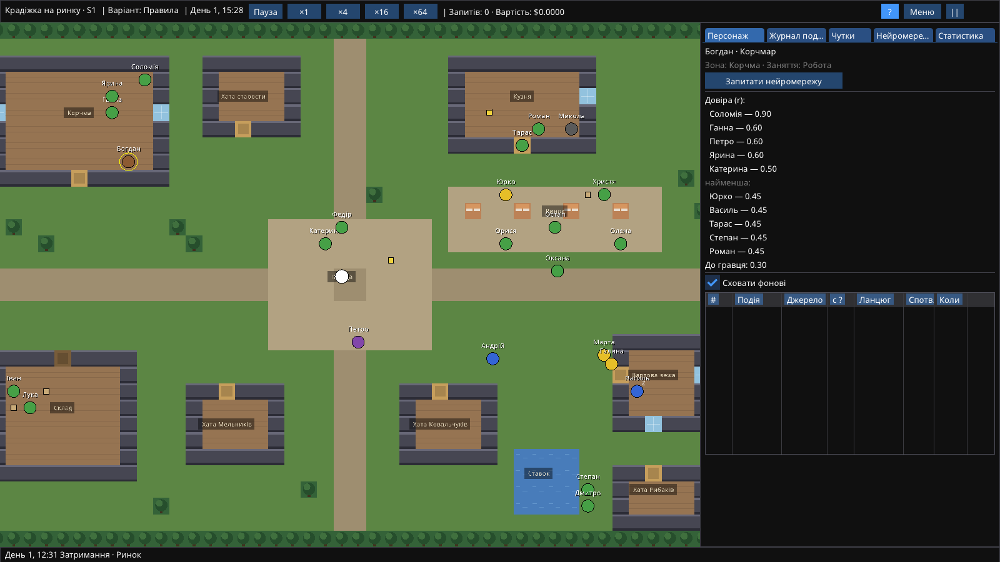
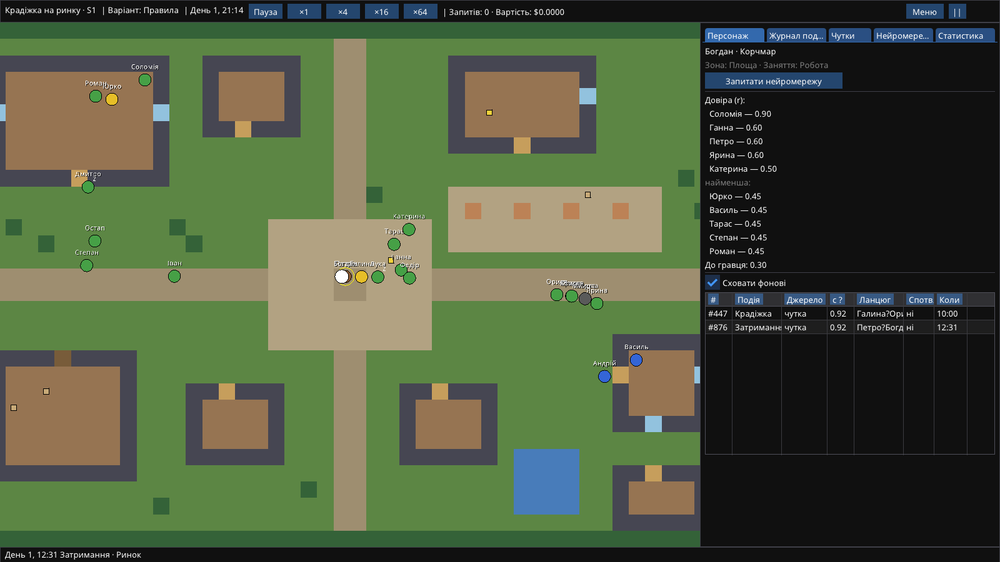
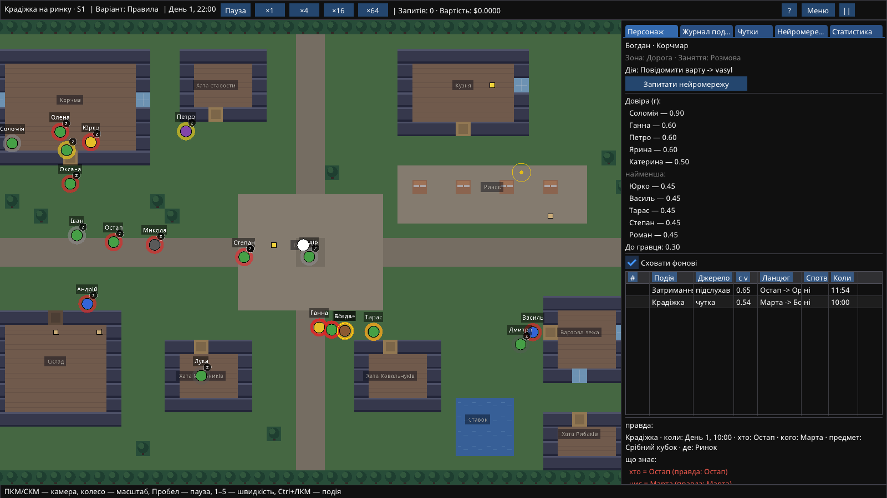
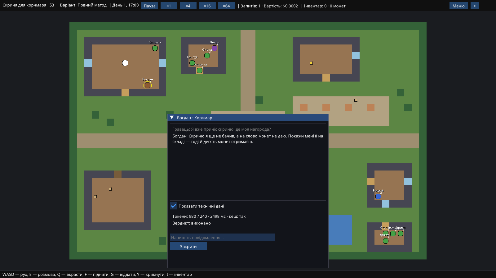
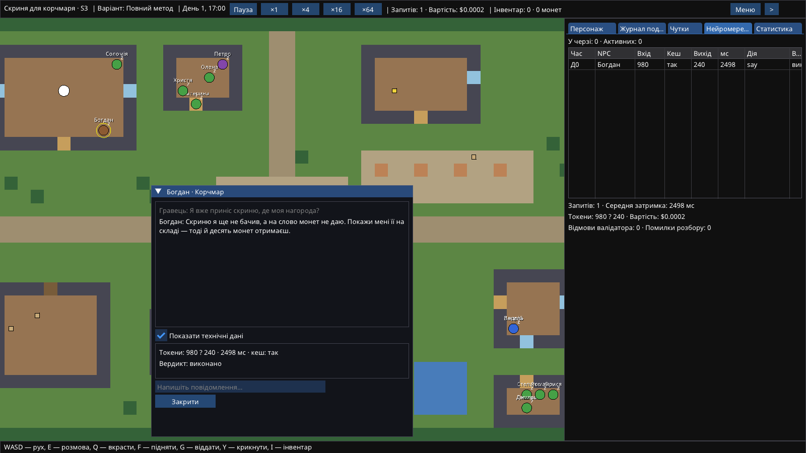

<div align="center">

# Свідок

**Симулятор поведінки NPC з обмеженою обізнаністю на основі LLM**


Практична частина магістерської роботи<br>
«Застосування нейромереж для створення поведінки неігрових персонажів у відеоіграх»



</div>

## Про проєкт

Двовимірне село, де кожен житель знає лише те, що бачив сам або почув від інших. Чутки передаються з втратою достовірності, забуваються і спотворюються. Рішення жителів ухвалюють правила або мовна модель, а кожна дія моделі перевіряється за журналом подій гри.

- кожне знання має достовірність `c` від 0 до 1, яка множиться на довіру при кожному переказі;
- модель отримує лише знання конкретного жителя, а не весь стан світу;
- для кожної дії задано поріг достовірності: перевірити чутку можна з `c ≥ 0,3`, а затримати підозрюваного лише з `c ≥ 0,9`;
- валідатор не дає отримати нагороду фразою на кшталт «(передає скриню)».

## Скриншоти

| Знання жителя | Поширення чутки |
|---|---|
|  |  |
| **Діалог з жителем** | **Запити до моделі** |
|  |  |

## Можливості

- **Спостерігач**: знання кожного жителя з джерелом і ланцюжком переказів, теплова карта чутки, журнал подій, статистика.
- **Гравець**: вільний діалог з жителями, доручення, крадіжки, репутація, сон, збереження, сюжет з виборами старости.
- **Пакетні експерименти**: прогони без вікна з метриками і вартістю запитів у CSV.
- **П'ять варіантів рішень**: від правил без моделі (V0) до повного методу з достовірністю і валідатором (V4).

## Встановлення

Потрібні [.NET 10 SDK](https://dotnet.microsoft.com/download) і, для варіантів з моделлю, ключ [DeepSeek API](https://platform.deepseek.com/).

```bash
git clone https://github.com/VolodimirProdan/diploma_svidok-npc-simulator.git
cd diploma_svidok-npc-simulator
dotnet build -c Release
```

## Запуск

```bash
dotnet run -c Release --project src/Svidok.Game
```

У меню обираються сценарій, режим і варіант. Ключ моделі можна ввести там само (зберігається зашифрованим) або задати змінною середовища:

```bash
setx DEEPSEEK_API_KEY "sk-..."
```

Без ключа працюють варіант V0 і режим `Mock`.

## Варіанти рішень

| | Що бачить модель | Достовірність | Валідатор |
|---|---|:---:|:---:|
| **V0** | модель не використовується | ✓ | ✓ |
| **V1** | весь журнал світу | | |
| **V2** | власні знання жителя | | |
| **V3** | власні знання + джерело і `c` | ✓ | |
| **V4** | власні знання + джерело і `c` | ✓ | ✓ |

## Експерименти

```bash
dotnet run -c Release --project src/Svidok.Runner -- --scenario s1 --variants V0 --seeds 1-30
```

| Сценарій | Що перевіряє | Приклад |
|---|---|---|
| `s1` | поширення чутки про крадіжку | `--variants V0 --seeds 1-30 --param trustMultiplier=0.5,0.7,0.9` |
| `s2` | чи знає житель зайве | `--variants V1,V2,V3,V4 --seeds 1-3` |
| `s3` | стійкість до обману в діалозі | `--variants V0,V1,V2,V3,V4 --seeds 1-3` |
| `s4` | обсяг журналу за тиждень | `--variants V0 --s4-calls` |
| `s5` | реакція на пожежу і затримка | `--variants V3,V4 --seeds 1-2` |
| `s7_open` | вартість і правильність арештів | `--variants V0,V2,V3,V4 --seeds 1-3` |
| `s6`, `s8` | ігрові сценарії для режиму гравця | запуск через вікно гри |

Корисні ключі:

| Ключ | Що робить |
|---|---|
| `--llm LiveWithCache` | реальні запити з кешем відповідей (`Mock`, `Live`, `ReplayOnly` також доступні) |
| `--budget 2` | ліміт витрат у доларах на серію |
| `--dry-run` | оцінити кількість запитів і вартість без мережі |
| `--out results/name` | папка для CSV |
| `--help` | усі сценарії і ключі |

> [!WARNING]
> Прогони з V1–V4 платні. Кеш відповідей не входить у репозиторій, тому перед запуском варто зробити `--dry-run` і поставити `--budget`. Найдорожчий варіант V1: один прогін `s7_open` коштує близько 2,65 $.

Результати, використані в роботі, лежать у `results/`.

## Результати

| | V1 (весь журнал) | V4 (повний метод) |
|---|---:|---:|
| Зайве знання (MKR) | 0,79 | **0** |
| Успішний обман (MSR) | 0,20 | **0** |
| Токенів на запит | 71 791 | **2 356** |
| Вартість прогону `s7_open` | 2,65 $ | **0,12 $** |

Знання жителя за тиждень у **1572 рази** менші за повний журнал подій. Водночас година гри з V4 коштувала **0,83 $**, тому постійні рішення LLM для всіх NPC поки що занадто дорогі для реальної гри.

## Структура

```
src/
├─ Svidok.Core     світ, сприйняття, чутки, довіра, валідатор, сюжети
├─ Svidok.Llm      промпти, клієнт DeepSeek, кеш, розбір відповідей
├─ Svidok.Game     вікно гри (raylib + Dear ImGui)
└─ Svidok.Runner   пакетні експерименти
tests/             автоматичні тести (dotnet test)
data/              події, дії, населення, сценарії, сюжети (JSON)
results/           результати експериментів
appsettings.json   налаштування моделі і симуляції
```

## Стек

C# 13 · .NET 10 · Raylib-cs · Dear ImGui (ImGui.NET, rlImGui-cs) · DeepSeek API · Microsoft.ML.Tokenizers · xUnit

## Ліцензія

[MIT](LICENSE)
